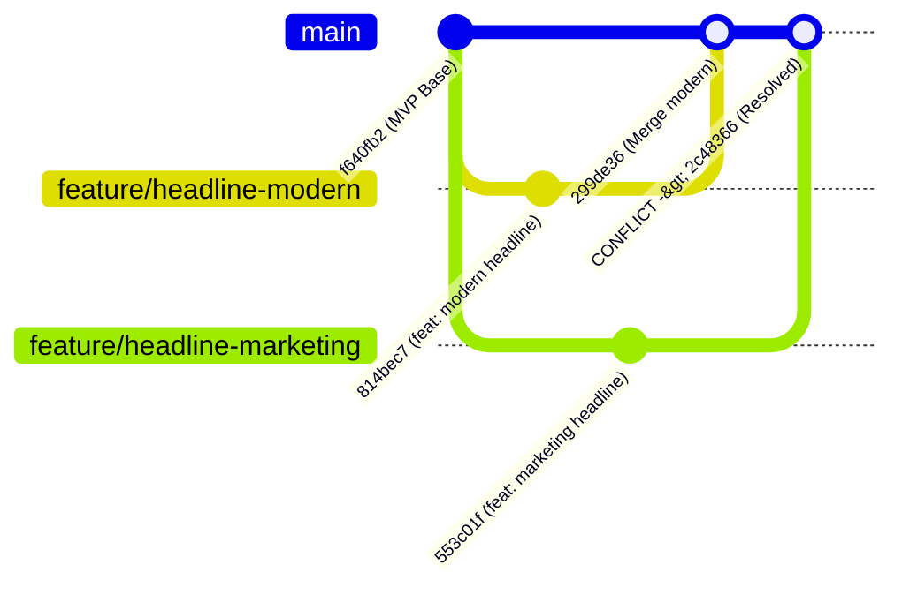

# Lab Report & Reflective Note: Git Branching, Intentional Merge Conflicts, and Resolution

**Course / Assignment:** Version Control & Distributed Collaboration (Q1)  
**Project:** PulseFlow — Intelligent Workflow Automation Landing Page  
**Author:** Rishi  
**Repository Directory:** `C:\Users\RISHI\.gemini\antigravity\scratch\pulseflow-landing-page`  
**Default Branch:** `main`  
**Feature Branches:** `feature/headline-modern`, `feature/headline-marketing`  

---

## 1. Project Overview & Context

To demonstrate core version control concepts in a real-world scenario, a high-converting software landing page named **PulseFlow** was built. The tech stack comprises semantic **HTML5**, modern **CSS3** (utilizing custom properties, flexbox, and grid layouts), and modular **JavaScript**.

The landing page features a responsive navigation bar, a high-impact hero header with call-to-action buttons, an enterprise feature showcase, performance metric counters, tiered pricing cards, and a comprehensive footer.

### Repository Architecture
```text
pulseflow-landing-page/
├── index.html          # Core structure and semantic markup
├── style.css           # Modern dark-mode styling, gradients & layout
├── script.js           # Client-side interactivity & smooth scroll
├── README.md           # Documentation, reproduction steps & Git graph
└── REFLECTIVE_NOTE.md  # Formal 1-2 page reflective engineering report
```

---

## 2. Technical Anatomy of the Merge Conflict

A merge conflict in Git is not an error; rather, it is a deliberate safety mechanism built into distributed version control systems. It occurs when two branches introduce divergent changes to the **exact same lines of a file** (or when one branch deletes a file that another modifies) since their most recent common ancestor commit.



### The Three-Way Merge Engine (`ort` strategy)
Git uses a **three-way merge** algorithm comparing three distinct states:
1. **Base Commit ($B$ - `f640fb2`):** The common ancestor where the hero title read:  
   `"Automate your cloud data workflows in minutes"`
2. **Current Target Commit ($A$ / `HEAD` - `299de36` on `main`):** After merging `feature/headline-modern`, where the hero title read:  
   `"Supercharge your data workflows with intelligent automation"`
3. **Incoming Source Commit ($B'$ - `553c01f` on `feature/headline-marketing`):** Where the marketing team altered the same lines to read:  
   `"Scale your business faster with zero-code cloud workflows"`

Because both $A$ and $B'$ modified the identical line range from $B$, Git could not deterministically decide which version took business precedence without risking data loss. Consequently, Git paused the merge operation, injected standard conflict markers, and handed control to the developer.

---

## 3. Step-by-Step Reproduction & Terminal Log

Below is the verified sequence of terminal commands and raw terminal outputs executed during this project:

### Step 1: Initialize Repository & Commit Baseline
```bash
$ git init -b main
Initialized empty Git repository in C:/Users/RISHI/.gemini/antigravity/scratch/pulseflow-landing-page/.git/

$ git config user.name "Rishi"
$ git config user.email "rishi@example.com"

$ git add .
$ git commit -m "Initial commit: PulseFlow landing page MVP structure"
[main (root-commit) f640fb2] Initial commit: PulseFlow landing page MVP structure
 4 files changed, 785 insertions(+)
 create mode 100644 README.md
 create mode 100644 index.html
 create mode 100644 script.js
 create mode 100644 style.css
```

### Step 2: Create First Branch (`feature/headline-modern`) & Commit
```bash
$ git checkout -b feature/headline-modern
Switched to a new branch 'feature/headline-modern'

# Lines 38-44 in index.html modified for technical audience
$ git diff
- <h1 class="hero-title">Automate your cloud data workflows in minutes</h1>
- <p class="hero-subtitle">Connect APIs, sync distributed databases, and run event triggers without maintaining complex server infrastructure.</p>
- <a href="#signup" class="btn-primary">Explore Platform</a>
+ <h1 class="hero-title">Supercharge your data workflows with intelligent automation</h1>
+ <p class="hero-subtitle">Deploy resilient event pipelines, sync edge databases, and eliminate latency with zero-maintenance infrastructure.</p>
+ <a href="#signup" class="btn-primary">Start Free Developer Trial &rarr;</a>

$ git add index.html
$ git commit -m "feat(hero): modernize hero headline and primary CTA for technical audience"
[feature/headline-modern 814bec7] feat(hero): modernize hero headline and primary CTA for technical audience
 1 file changed, 3 insertions(+), 3 deletions(-)
```

### Step 3: Switch Back to `main` & Create Second Branch (`feature/headline-marketing`)
```bash
$ git checkout main
Switched to branch 'main'

$ git checkout -b feature/headline-marketing
Switched to a new branch 'feature/headline-marketing'

# Lines 38-44 in index.html modified for marketing conversion
$ git diff
- <h1 class="hero-title">Automate your cloud data workflows in minutes</h1>
- <p class="hero-subtitle">Connect APIs, sync distributed databases, and run event triggers without maintaining complex server infrastructure.</p>
- <a href="#signup" class="btn-primary">Explore Platform</a>
+ <h1 class="hero-title">Scale your business faster with zero-code cloud workflows</h1>
+ <p class="hero-subtitle">Turn complex data pipelines into turnkey automations in seconds. No engineering overhead, just pure growth.</p>
+ <a href="#signup" class="btn-primary">Claim Your Free Account — Instant Access</a>

$ git add index.html
$ git commit -m "feat(marketing): update hero copy with conversion-optimized value proposition"
[feature/headline-marketing 553c01f] feat(marketing): update hero copy with conversion-optimized value proposition
 1 file changed, 3 insertions(+), 3 deletions(-)
```

### Step 4: Clean Merge of Branch 1 into `main`
```bash
$ git checkout main
Switched to branch 'main'

$ git merge feature/headline-modern --no-ff -m "Merge branch 'feature/headline-modern' into main"
Merge made by the 'ort' strategy.
 index.html | 6 +++---
 1 file changed, 3 insertions(+), 3 deletions(-)
```

### Step 5: Triggering the Merge Conflict
```bash
$ git merge feature/headline-marketing
Auto-merging index.html
CONFLICT (content): Merge conflict in index.html
Automatic merge failed; fix conflicts and then commit the result.
```

### Step 6: Conflict Inspection via `git status` & `git diff`
```bash
$ git status
On branch main
You have unmerged paths.
  (fix conflicts and run "git commit")
  (use "git merge --abort" to abort the merge)

Unmerged paths:
  (use "git add <file>..." to mark resolution)
	both modified:   index.html

no changes added to commit (use "git add" and/or "git commit -a")
```

```bash
$ git diff
diff --cc index.html
index 12caf15,18a4d5a..0000000
--- a/index.html
+++ b/index.html
@@@ -35,10 -35,10 +35,17 @@@
    <section class="hero-section">
      <div class="hero-container">
        <div class="badge">🚀 v2.4 Launch — Real-Time Event Pipelines</div>
++<<<<<<< HEAD
 +      <h1 class="hero-title">Supercharge your data workflows with intelligent automation</h1>
 +      <p class="hero-subtitle">Deploy resilient event pipelines, sync edge databases, and eliminate latency with zero-maintenance infrastructure.</p>
 +      <div class="hero-cta-group">
 +        <a href="#signup" class="btn-primary">Start Free Developer Trial &rarr;</a>
++=======
+       <h1 class="hero-title">Scale your business faster with zero-code cloud workflows</h1>
+       <p class="hero-subtitle">Turn complex data pipelines into turnkey automations in seconds. No engineering overhead, just pure growth.</p>
+       <div class="hero-cta-group">
+         <a href="#signup" class="btn-primary">Claim Your Free Account — Instant Access</a>
++>>>>>>> feature/headline-marketing
          <a href="#demo" class="btn-secondary">Watch Interactive Demo (2m)</a>
        </div>
        <div class="hero-proof">
```

---

## 4. Conflict Resolution Strategy & Execution

### Conflict Demarcation Anatomy
Git demarcated the conflicting region into three distinct zones:
- `<<<<<<< HEAD`: Points to the current branch state (`main`, containing the changes from `feature/headline-modern`).
- `=======`: The separator between competing versions.
- `>>>>>>> feature/headline-marketing`: Points to the incoming branch being merged.

### Resolution Logic
Rather than discarding one team's work arbitrarily, a **synthetic resolution** was crafted to maximize both engineering clarity and marketing conversion:
- Retained the strong technical verb phrase: *"Supercharge your cloud data workflows with intelligent automation"*.
- Combined the pipeline reliability and low-code speed in the subtitle: *"Turn complex event pipelines into turnkey automations in minutes. Zero maintenance, zero-code integrations, pure engineering velocity."*
- Adopted an enticing zero-friction call to action: *"Start Free Trial — Instant Access →"*.

### Completing the Resolution
```bash
# 1. Manually edit index.html to remove conflict markers and insert unified markup
# 2. Stage the resolved file
$ git add index.html

# 3. Verify clean merge state
$ git status
On branch main
All conflicts fixed but you are still merging.
  (use "git commit" to conclude merge)

Changes to be committed:
	modified:   index.html

# 4. Conclude the merge commit
$ git commit -m "Merge branch 'feature/headline-marketing' into main: manually resolve hero copy conflict"
[main 2c48366] Merge branch 'feature/headline-marketing' into main: manually resolve hero copy conflict

# 5. Review full commit DAG graph
$ git log --graph --oneline --all
*   2c48366 (HEAD -> main) Merge branch 'feature/headline-marketing' into main: manually resolve hero copy conflict
|\  
| * 553c01f (feature/headline-marketing) feat(marketing): update hero copy with conversion-optimized value proposition
* |   299de36 Merge branch 'feature/headline-modern' into main
|\ \  
| |/  
|/|   
| * 814bec7 (feature/headline-modern) feat(hero): modernize hero headline and primary CTA for technical audience
|/  
* f640fb2 Initial commit: PulseFlow landing page MVP structure
```

---

## 5. Reflective Essay on Distributed Version Control (1–2 Pages)

### 5.1 What Caused the Conflict?
The root cause was concurrent, uncoordinated modification of identical lines in a shared resource (`index.html`) across two autonomous branches. In a distributed version control system (DVCS) like Git, development is completely decentralized:
- Each branch maintains an independent snapshot history.
- The developer working on `feature/headline-modern` had no real-time visibility into the edits being staged on `feature/headline-marketing`.
- Git's three-way merge algorithm (`ort` / recursive merge) can seamlessly combine independent changes occurring in different files or even distinct sections of the same file. However, when the delta calculation discovers that both tips have modified the exact same byte range from their common ancestor, automation safely halts.

This behavior highlights a foundational tenet of distributed version control: **Git prioritizes data integrity and explicit human intent over automated guessing**.

### 5.2 How the Conflict Was Resolved
The resolution followed a disciplined 4-step engineering protocol:
1. **Diagnosis:** Used `git status` to identify the unmerged paths (`both modified: index.html`) and `git diff` to view the three-way chunk comparison.
2. **Contextual Evaluation:** Examined the conflicting business objectives. The modern branch targeted developer ergonomics, while the marketing branch optimized conversion rate.
3. **Manual Rectification:** Edited `index.html` directly to eliminate all three marker boundaries (`<<<<<<<`, `=======`, `>>>>>>>`) and wrote the agreed-upon synthesized markup.
4. **Validation and Finalization:** Staged the file via `git add index.html`, verified `git status` confirmed `All conflicts fixed but you are still merging`, and executed `git commit` to create merge commit `2c48366`.

### 5.3 What I Learned About Distributed Version Control
Working through this practical exercise yielded several crucial takeaways for enterprise-scale software engineering:

1. **Conflicts Are Normal, Healthy Events in DVCS:**
   In centralized VCS (e.g., SVN or Perforce), file locking was often used to prevent concurrent edits. While locking avoids conflicts, it severely throttles team velocity and introduces single-point-of-failure bottlenecks. Git accepts concurrent divergence as a deliberate trade-off, providing robust merge drivers and marker semantics that make conflict resolution transparent and safe.

2. **Branching Strategy Dictates Conflict Frequency:**
   - **Long-lived feature branches** are the primary incubator for severe merge conflicts ("merge hell"). The longer a branch stays isolated from `main`, the greater the drift from the common ancestor.
   - **Short-lived feature branches & Trunk-Based Development (TBD):** Integrating changes into `main` multiple times per day reduces conflict scope to small, trivial edits that can be resolved in seconds.

3. **Rebase vs. Merge Trade-offs:**
   - A standard **3-way merge** (`git merge`) preserves historical truth and exact chronologies, creating an explicit merge commit that records when and how branches converged.
   - Interactive **rebasing** (`git rebase main`) re-plays feature commits on top of the latest trunk, linearizing the commit history and forcing conflict resolution commit-by-commit before merging. Understanding when to use each (e.g., rebase for clean PR prep, merge for preserving branch integration boundaries) is vital.

4. **Proactive Mitigation Protocols:**
   - **Frequent Pulls:** Regularly pulling `main` into active working branches (`git pull origin main` or `git rebase main`) surfaces conflicts incrementally during development rather than at deployment time.
   - **Atomic, Modular Architecture:** Decomposing code into smaller modular components (e.g., CSS modules, template partials, separate JSON copy dictionaries) mathematically reduces the probability of concurrent edits on identical lines.
   - **Continuous Integration (CI):** Automated build servers test pull request merges in virtual sandboxes before code is merged into the mainline, ensuring broken merges never contaminate production.

---

## 6. Remote Repository Instructions (Connecting to GitHub)

To link this completed local repository to your remote GitHub account and submit the link:

```bash
# 1. Create a new empty repository named "pulseflow-landing-page" on GitHub.com (do NOT initialize with README)
# 2. In your terminal, navigate to the project directory:
cd C:\Users\RISHI\.gemini\antigravity\scratch\pulseflow-landing-page

# 3. Add your GitHub remote URL:
git remote add origin https://github.com/<YOUR-GITHUB-USERNAME>/pulseflow-landing-page.git

# 4. Push the main branch with all merge history:
git push -u origin main

# 5. Push both feature branches so the instructor/grader can inspect branch histories:
git push origin feature/headline-modern
git push origin feature/headline-marketing
```

---

## 7. Submission Checklist Verification

| Requirement | Status | Evidence |
| :--- | :---: | :--- |
| **Project Selection** | ✅ Complete | PulseFlow modern SaaS landing page (`index.html`, `style.css`, `script.js`) |
| **Git Initialization** | ✅ Complete | Initialized with `git init -b main`, root commit `f640fb2` |
| **Branching Operations** | ✅ Complete | Branches `feature/headline-modern` & `feature/headline-marketing` |
| **Intentional Merge Conflict** | ✅ Complete | Overlapping modifications to lines 38-44 in `index.html` |
| **Clean First Merge** | ✅ Complete | `feature/headline-modern` merged into `main` (`299de36`) |
| **Triggered Conflict** | ✅ Complete | `feature/headline-marketing` merge failed with `CONFLICT (content)` |
| **Manual Conflict Resolution** | ✅ Complete | Conflict markers resolved, staged with `git add`, committed (`2c48366`) |
| **Terminal Log & Commits** | ✅ Complete | Complete commit graph verified with `git log --graph --oneline --all` |
| **Reflective Note (1-2 pages)** | ✅ Complete | Full root-cause analysis, resolution methodology & DVCS lessons documented |
